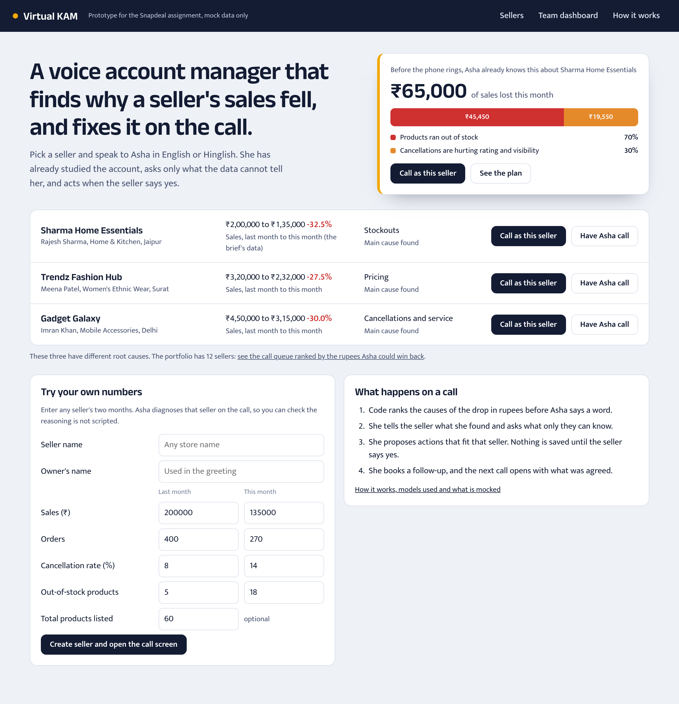
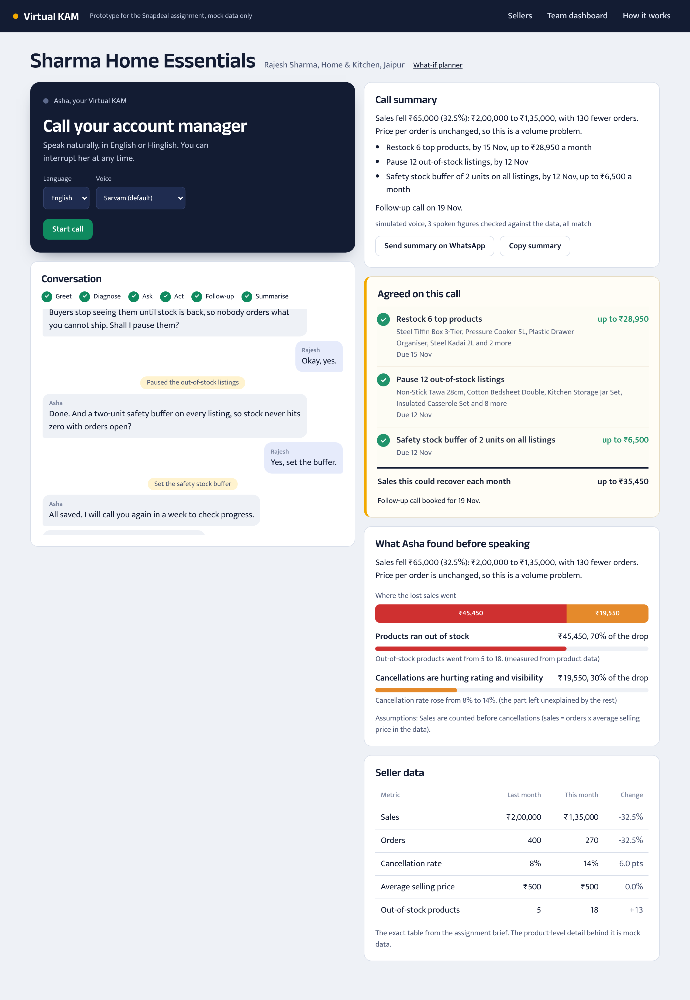
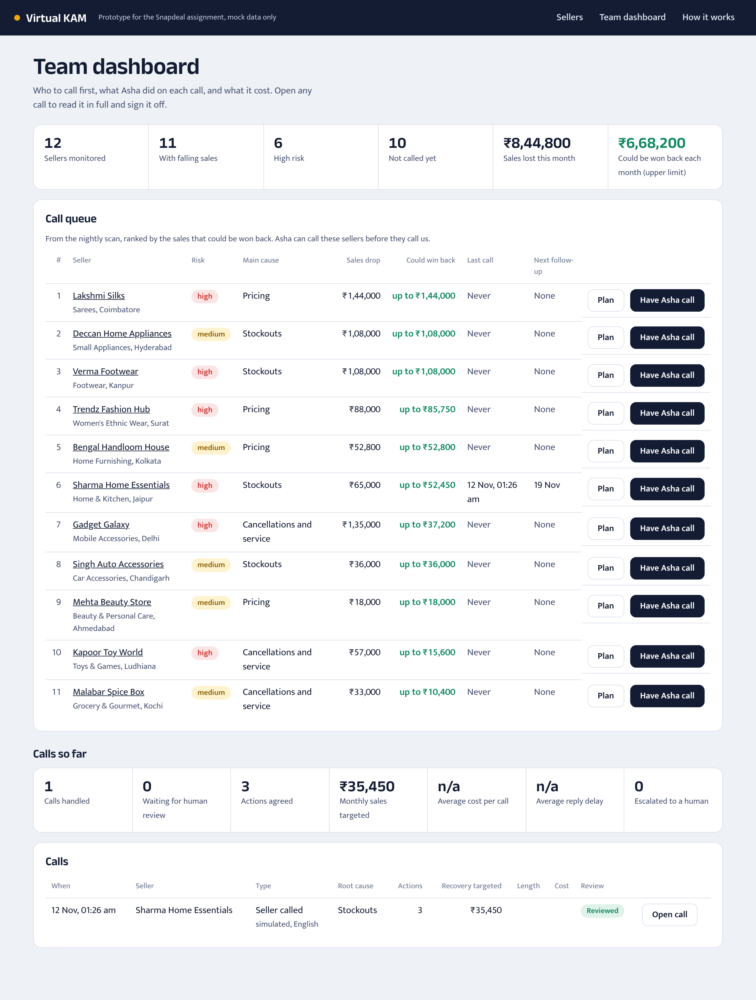
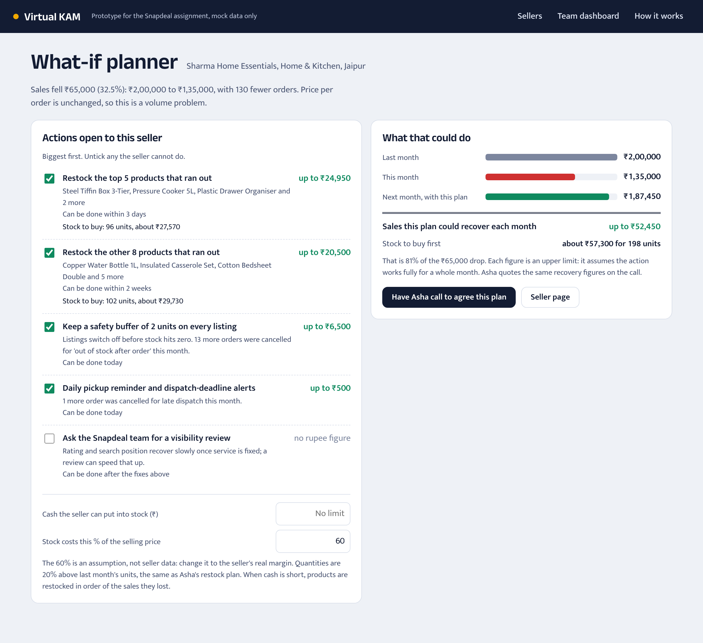
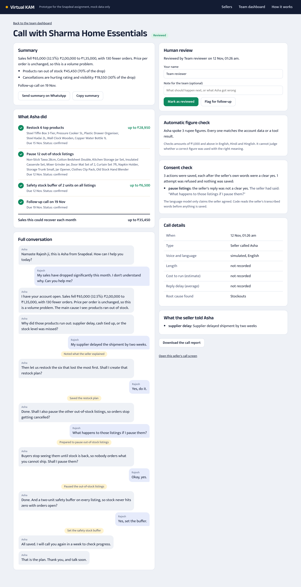
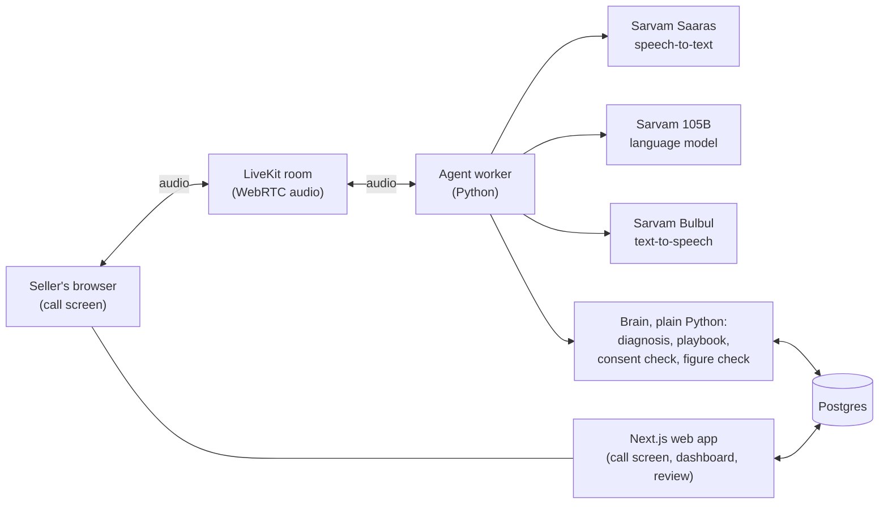

# Virtual KAM: a voice agent that owns a seller's sales problem

Built for the Snapdeal AI First Intern assignment. A seller talks to "Asha", an AI Key Account
Manager, in the browser. Asha has already studied the account, explains why sales dropped,
asks only what the data cannot tell her, takes actions when the seller agrees, books a
follow-up, and remembers all of it on the next call.

Everything runs on mock data. Seller S1 is the exact table from the assignment brief.

[](https://github.com/alphasafal/snapdeal-virtual-kam/actions/workflows/tests.yml)

<!-- DEMO VIDEO: replace this comment with a line such as   **Demo video (2 min):** https://...   -->

## At a glance

| | |
|---|---|
| **Voice** | Real-time streaming audio over WebRTC, not record-and-wait. The seller can interrupt Asha mid-sentence. English, Hindi and Hinglish, using speech models built for Indian accents. |
| **Diagnosis** | Plain Python splits the ₹65,000 drop into causes: ₹45,450 from stockouts (measured), ₹19,550 from lost visibility (inferred, and labelled as such). The language model never calculates. |
| **Ownership** | Asha saves actions during the call, books a follow-up, and opens the next call with what was agreed. A nightly scan ranks all twelve sellers by the rupees that could be won back, so she calls the right ones first. After a call, the summary can be sent to the seller on WhatsApp in one tap. |
| **Planning** | A what-if planner for every seller: tick the actions they can take and see next month's sales, the stock that has to be bought first, and the margin a price match gives up. Enter the cash the seller has and the plan shrinks to the products it covers. It quotes the same figures Asha says on the call, and tests check that. |
| **Trust** | An action is saved only if the seller's own words were a clear yes, and the call record lists every attempt that was refused, with the words the seller actually said. After every call each rupee figure Asha spoke is checked against the data. A person can review and sign off any call. |
| **Evidence** | 142 automated tests, including the real agent run against a scripted model. Twelve sellers across four situations (stockouts, rival pricing, late dispatch, and one that is growing), plus a form to enter any numbers. |

## How it meets the brief

| The brief asks for | Where it is |
|---|---|
| Greet the seller and understand the reason for the call | Asha greets the seller by name and asks how she can help. She does not give the diagnosis until the seller has said why they called. She can also place the call herself ("Have Asha call"). |
| A natural two-way voice conversation | Streaming audio both ways over WebRTC (LiveKit), with speech models built for Indian accents (Sarvam). The seller can interrupt. English, Hindi and Hinglish. |
| Relevant follow-up questions | One question at a time, at most three, and only what the data cannot answer: for example why the products ran out. The answer is saved and shapes the plan. |
| Use the sample data to find issues: pricing, inventory, cancellations, visibility | `agent/brain/diagnosis.py` tests all four. For the brief's seller: price is flat, so pricing is ruled out; stockouts explain ₹45,450; the rest is put down to lost visibility from cancellations, and labelled as inferred. |
| Recommend 2 to 3 practical actions | Code picks the three actions that fit this seller, biggest first (for the brief's seller: restock the top five, pause what cannot ship, keep a stock buffer). Each comes with what it may win back, and is saved only after a yes. |
| Summarise issues, recommendations and next steps | A spoken summary at the end, the same summary on screen, a booked follow-up date, and a one-tap WhatsApp message with it. |
| Voice-first, mock data only, a short note | The call screen is a voice call (typing is a fallback for when a microphone cannot be used). All data is mock data. The note is `docs/SUBMISSION_NOTE.pdf`. |

## What it looks like

The home page: the seller from the brief, already diagnosed, and two more with different causes.



The call screen after a call: the conversation, what was agreed, and what Asha found before she spoke.



The team dashboard: a call queue ranked by the sales that could be won back, then every call with its review status.



The what-if planner for one seller.



One call's full record, with the automatic figure check and human review.



These screens were captured with the scripted call simulator (`agent/simulate_call.py`), which
needs no keys or microphone. Its script includes one deliberate early attempt to pause listings
while the seller is still asking a question, so the call record shows a refused attempt.

## How it fits together



The agent and the web app never call each other: both read and write the database, so calls
are independent and more agent workers can be added without changing anything else.

**`docs/LIVE_CALL_TEST.md`** is the record of a full call against the real services, with what
was checked, what it found and the whole conversation.

**`docs/ARCHITECTURE.md`** has the full design: a step-by-step call diagram, why each part was
chosen and what it costs, the data model, how it grows to one lakh sellers, and what happens
when each part fails.

## What is in here

New to the code? Read **`docs/CODE_TOUR.md`** first. It explains every file in one line,
follows one call through the code, and lists the words used.

| Folder | What it is |
|---|---|
| `agent/agent.py` | The voice agent (LiveKit Agents), in five labelled parts. |
| `agent/brain/` | Diagnosis engine, tools, what-if planner, consent check, figure check, database layer, mock data. Plain Python, no LLM. |
| `agent/prompts.py` | The agent's instructions. |
| `agent/speech_filter.py` | Keeps any leaked model reasoning out of what is spoken. |
| `agent/tests/` | 142 tests, including the real agent run in a text-only session with a scripted LLM. |
| `web/` | Next.js app: call screen, "try your own numbers", team dashboard with the call queue, what-if planner, call records and human review, how-it-works page. |
| `docs/` | Architecture, code tour, submission note, recording script, deploy guide. |

## Accounts you need (all have free tiers)

1. **Sarvam** – speech-to-text, LLM and text-to-speech. One key.
2. **LiveKit Cloud** – carries the audio. Create a project, copy URL, API key and secret.
3. **Neon** (or any Postgres) – copy the connection string.
4. Optional: **Google AI Studio** key if you want to try `VOICE_MODE=gemini`.

## Run it locally

Quickest: `./start.sh` from the project root does all of the steps below and runs the built web app (`--reset` also wipes call history, `--dev` uses hot-reload mode).

```bash
# 1. Agent
cd agent
python3 -m venv .venv && source .venv/bin/activate
pip install -r requirements.txt
cp .env.example .env          # fill in the keys (skip if .env already exists)
python hello_sarvam.py        # first Sarvam call: writes hello_sarvam.wav
python -m pytest -q           # 142 tests, no keys needed
python -m brain.seed          # creates tables and the twelve mock sellers (wipes calls)
python agent.py console       # optional: talk to Asha in the terminal
python agent.py dev           # leave this running; it waits for calls

# 2. Web app (second terminal)
cd web
cp .env.example .env.local    # same DATABASE_URL and LiveKit keys
npm install
npm run dev                   # open http://localhost:3000
```

No microphone or keys handy? `python simulate_call.py` plays a scripted call into the database
so you can see the transcript, action panel, summary and dashboard working.

## Deploy

See `docs/DEPLOY.md` for a public link (hosted database, agent on LiveKit Cloud, web app on Vercel).
For a recording, the agent on your laptop is enough.

## Voice settings

| Setting (in `agent/.env`) | Default | What it does |
|---|---|---|
| `VOICE_MODE` | `sarvam` | Default voice: `sarvam` pipeline or `gemini` (Gemini Live). The call screen can also choose per call. |
| `GOOGLE_API_KEY` | unset | Needed for Gemini Live. If the key or model is unavailable the call falls back to Sarvam. `python hello_gemini.py` checks it. |
| `SARVAM_STT_TRANSPORT` | `auto` | `auto` = live websocket with per-sentence HTTPS as fallback; `http` or `ws` forces one |
| `SARVAM_TTS_MODEL` | unset | unset = Bulbul v4 Flash first, Bulbul v3 as fallback; set a model name to force it |
| `SARVAM_REASONING_EFFORT` | `none` | model "thinking" is off: it made replies slow and leaked into speech |
| `LLM_TIMEOUT_S` | `4` | seconds of silence from the language model before the request is retried |
| `SARVAM_TTS_PACE` | `1.1` | how fast Asha speaks; `1.0` is the voice's natural speed |
| `NOISE_CANCELLATION` | unset | `bvc` removes background voices and noise from the seller's audio (needs `pip install livekit-plugins-noise-cancellation` and LiveKit Cloud). Opt-in: not yet tried on a live call |
| `ENDPOINT_MAX_DELAY` | `1.6` | longest wait (seconds) before deciding the seller has finished; raise it if sellers get cut off mid-thought |

## Safeguards that do not rely on the model behaving

| Safeguard | Where | What it does |
|---|---|---|
| Consent gate | `agent/brain/consent.py` | An action is saved only if the seller's own last words clearly agreed to that specific action. A question, or a yes to a different question, does not count. One yes covers at most two actions. |
| Consent record | call record page | Every time the model said the seller had agreed, the gate's decision is kept: how many actions it let through, and each attempt it refused with the seller's actual words. |
| Undo | `cancel_action` tool | If the seller says they did not want something, it is removed and its effects are reversed. |
| Figure check | `agent/brain/audit.py` | After every call, each rupee amount the agent spoke (English, Hindi, Hinglish) is compared with the account data and tool results. Anything unmatched is flagged on the call record. |
| Reasoning filter | `agent/speech_filter.py` | Leaked model reasoning never reaches the voice or the transcript. |
| Playbook | `KamTools.playbook()` | Code decides which actions fit this seller, biggest problem first. |

These came from real test calls: a model acted without consent, invented an answer, and said
"6 lakh" for 2 lakh. On a live Hindi call the consent gate itself was too strict: it refused
"कर दीजिए।" because speech-to-text ends sentences with "।", and it refused a "ठीक है" that came
back in Gurmukhi script. Each failure is now a test case.

## Human review

Every finished call has its own page (Team dashboard, then "Open call") with the summary, every
action, the full conversation including what the agent looked up, and what the seller said.
A team member can mark the call as reviewed or flag it for follow-up, with a note, and download
the whole record as one file to attach to a ticket or pass to a human account manager.

## Reliability choices

- One worker process is kept warm and its database connection is kept open, so that work is not
  done while the seller waits. `agent.log` prints how long each call took to set up.
- A language-model request that sends nothing for four seconds is abandoned and retried at once
  (`LLM_TIMEOUT_S`). On a live call, waiting the default ten seconds twice gave a 25-second silence.
- Asha's goodbye cannot be interrupted, so a background noise cannot cut the call off mid-sentence.
- No microphone? The call still connects in typing mode: the seller types, Asha answers aloud, and
  every tool, consent check and record works the same way.
- `GET /api/health` on the web app answers 200 only when the database is reachable.

- Transcription and voice each have a fallback, and the call survives up to 12 provider errors.
- If the call does drop, the page says so and the next call picks up from what was agreed.
- The call record is written the moment the conversation ends.
- `MAX_CALLS_PER_HOUR` (web, default 60) caps spend on a public demo link.

## Assumptions

The brief gives five numbers for two months and says assumptions must be stated. These are mine.

| Assumption | Why, and where it is used |
|---|---|
| Sales are counted before cancellations | In the brief, sales = orders × average selling price in both months (400 × ₹500, 270 × ₹500). So cancelled orders are a share of those orders: 14% of 270 is 38 orders, worth ₹18,900. |
| The seller lists 60 products | The brief gives out-of-stock counts but no catalogue size. Used for a seller entered with totals only. |
| Product-level data for the brief's seller | I invented 60 products whose units and prices add up exactly to the brief's sales and orders in both months (a test checks this). Thirteen of them ran out this month. This is what lets the diagnosis measure the stockout loss (₹45,450) instead of guessing it. |
| The rest of the drop is lost visibility | ₹19,550 is what is left after the measured stockout loss. It is put down to lower search position from cancellations and rating, and labelled "inferred" everywhere, including to Asha. |
| Visits, rating, rival prices, late-dispatch rate, cancellation reasons | Not in the brief. Mock values I added so pricing and service causes can be tested. |
| Eleven more sellers (S2 to S12) | Mock sellers with different causes: rival pricing, late dispatch, stockouts, and one that is growing. |
| Stock costs 60% of the selling price | Used only by the what-if planner, to say how much cash a restock needs. It is shown as an assumption on that page and can be changed there. |
| A restock orders 20% above last month's units | So the product does not run out again straight away. |
| Recovery figures are upper limits | Each assumes the action works fully for a whole month. Asha says "up to". |

## What is real and what is mocked

Real: the voice conversation, the diagnosis arithmetic, tool calls, saved actions, call memory,
the dashboard, cost and response-time tracking.

Mocked: all seller data; the effect of actions (a restock plan is a saved record, not a purchase
order; "paused" and "repriced" only change the mock product table); the WhatsApp summary is not sent.
