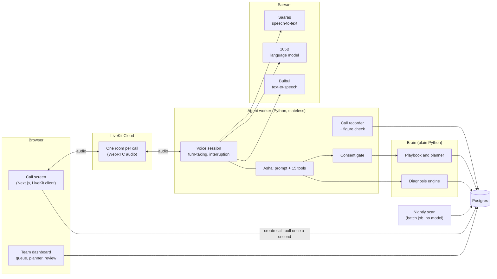
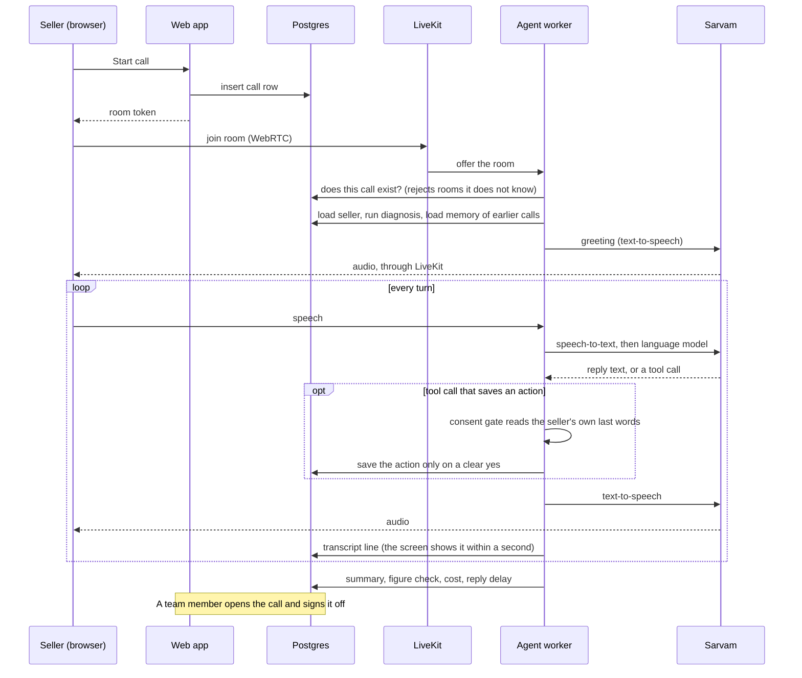
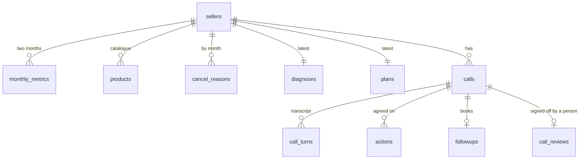

# Architecture

How the system is put together, why each choice was made, how it would grow to one lakh
sellers, and what happens when something fails. For a file-by-file guide, read `CODE_TOUR.md`.

## The idea behind the design

A voice agent that owns a seller's problem has to be trusted with numbers and with actions.
So the design splits the work in two:

| The language model does | Code does |
|---|---|
| Talks naturally in English, Hindi and Hinglish | Works out why sales fell, in rupees (`brain/diagnosis.py`) |
| Decides what to ask next | Chooses which actions fit this seller (`KamTools.playbook()`, `brain/planner.py`) |
| Decides when to use a tool | Checks the seller really said yes before saving anything (`brain/consent.py`) |
| | Checks afterwards that every rupee figure spoken was true (`brain/audit.py`) |

Everything on the right is plain Python with tests. A wrong word from the model can make a
call awkward; it cannot change a number or save an action the seller did not agree to.

## Components

The web app and the agent never call each other. Both read and write Postgres, and audio goes
through LiveKit. That one decision is what keeps the agent stateless.

## One call, step by step

## Why these parts

| Choice | Why | What it costs |
|---|---|---|
| LiveKit Agents (WebRTC) | Real phone-style audio: low delay, the seller can interrupt, works in any modern browser, and the same agent can take phone calls through SIP | An extra service to run |
| Sarvam for listening, thinking and speaking | Built for Indian accents and mixed Hindi-English; one vendor and one key; priced in rupees per minute | A three-step pipeline is slower than one speech-to-speech model |
| Gemini Live as a per-call option | Shows the trade-off: more fluid, but it slipped on numbers in testing | Kept off by default |
| Diagnosis, playbook and planner in code | Numbers are exact, testable and cost nothing per call | Each new cause needs code, not a prompt change |
| Consent checked in code | A model cannot claim a yes the seller did not give | Occasionally asks twice; each case found is now a test |
| Postgres as the only shared state | Workers stay stateless; the dashboard needs no separate API | The call screen polls once a second instead of streaming |
| A nightly batch scan | Ranks every seller with no model cost, so Asha can call first | Rankings are a day old |

## Data model

## Growing to one lakh sellers

These are estimates from the design and published prices. Nothing here has been load-tested.

| Question | Answer |
|---|---|
| How many calls at once? | One lakh sellers at 8 call minutes a month is 8 lakh minutes. Spread over working hours that averages about 50 calls at once, perhaps 150 at peak. |
| What limits a worker? | Memory: each call is its own process. Plan on roughly 10 to 20 calls per 4-core, 8 GB worker until measured. |
| How does it scale out? | Add workers. LiveKit spreads calls across them; because no state lives in a worker, nothing else changes. |
| What about the database? | Each call makes a few dozen small reads and writes. One Postgres instance with a connection pooler is enough at this size; read replicas for the dashboard come later. |
| What does it cost? | About ₹1.4 to ₹1.8 per call minute, so roughly ₹11 to ₹14 per seller per month at 8 minutes. The nightly scan has no model cost. |
| What changes first? | Replace polling on the call screen with LiveKit data messages, add login for the team dashboard, and move the scan to a scheduler. |

## When something fails

| Failure | What happens |
|---|---|
| Speech-to-text connection drops | Falls back from the live connection to per-sentence requests; the call continues |
| Text-to-speech model fails | Falls back to the second voice model |
| The language model sends nothing | The request is abandoned after four seconds and retried at once |
| The seller's network drops | The call is recorded as dropped; the next call opens with what was agreed |
| A worker dies mid-call | The dashboard closes the call record after 30 minutes and marks it |
| The model claims consent it did not get | The tool refuses and tells the model to ask; nothing is saved |
| The model says a wrong rupee figure | The figure check flags the call for the human reviewer |
| Someone opens rooms on the LiveKit project | The worker only joins rooms that match a call row in its database |
| A public demo link is abused | The web app caps calls per hour (`MAX_CALLS_PER_HOUR`) |

## Known limits

- All seller data is mock data; actions are saved records and touch no real system.
- Not load-tested, and the team dashboard has no login.
- On a laptop the first ring can take several seconds, and replies take two to three seconds.
- Recovery figures are upper limits; Asha says "up to".
